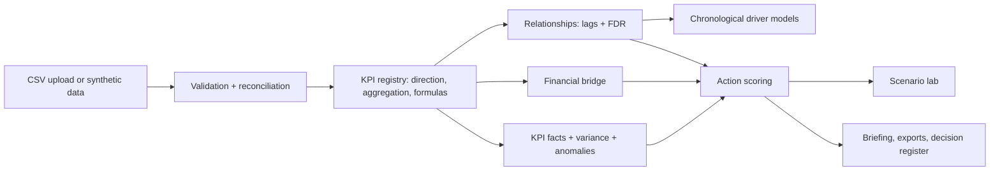

# PRISM AI — Executive Decision Intelligence
Beyond the numbers. Into the decisions.

PRISM AI connects fragmented departmental KPIs to financial outcomes and turns the evidence into a prioritised, traceable decision workflow: KPI catalogue, relationship explorer, driver models, financial impact bridge, variance and anomaly intelligence, decision scoring and a scenario lab. The bundled data is **fictional synthetic data** (36 months, 6 departments, 36 KPIs, 3 segments, actual and budget) with a few planted relationships.

## How PRISM AI works: the 10-step algorithm
1. **Ingest and map.** Load the four CSV tables (or the synthetic demo), map your column names to the schema, and keep the raw data unchanged.
2. **Validate and reconcile.** Check required fields, dates, numbers, duplicates, unknown KPI ids, units, missing months and the identities *gross profit = revenue − COGS* and *operating profit = gross profit − opex*. Problems are reported with row references; nothing is silently dropped or imputed.
3. **Standardise the grain.** Normalise to one monthly grain per segment, then apply the KPI registry: unit, direction (higher or lower is better), aggregation (sum or mean) and derived formulas such as margin percentages.
4. **Compute KPI facts.** For the chosen period: actual, prior month, year-on-year, budget variance, direction-aware status (favourable, unfavourable, on track), 12-month trend and data completeness.
5. **Detect variances and anomalies.** Apply the materiality threshold, then robust z-scores against a recent median and an Isolation Forest across all KPIs. Each flag explains itself; an unusual value is not assumed to be an error.
6. **Explain with arithmetic first.** Build an exact financial bridge: revenue = traffic × conversion × AOV (log-mean decomposition, no double counting) and operating profit = volume + margin rate + opex. Unexplained parts are shown, not hidden.
7. **Screen relationships.** Align KPIs by month and segment, test lags 0–3 with Pearson and Spearman, control false discoveries (Benjamini–Hochberg) and label each link supported, tentative or not supported. Association only, never causation.
8. **Model drivers chronologically.** Compare a naive baseline, a Ridge model and a random forest on a chronological train/test split with training-only standardisation and lagged features; report skill against the baseline; explain with coefficients and VIF.
9. **Turn evidence into decisions.** Generate candidate actions from variances, bridge contributors, supported drivers and anomalies; rank them with configurable weights for impact, urgency, evidence, effort, feasibility and risk. The score is a ranking aid, not a probability.
10. **Test, report and track.** Stress the plan in the scenario lab (base, downside, upside, sensitivity), write the briefing from the computed numbers, export CSV and Markdown, and record accept / reject / complete decisions for human review.

## Architecture


## Run
```
pip install -r requirements.txt
python app.py
```
In Google Colab, paste `app.py` into one cell and run it. The `src/` modules in the brief are consolidated into `app.py`.

## Sample schemas
`financial_performance.csv` (period, segment, revenue, cogs, gross_profit, opex, operating_profit); `operational_kpis.csv` (period, segment, kpi_id, value); `budget_actuals.csv` (period, segment, kpi_id, actual, budget); `kpi_dictionary.csv` (kpi_id, name, department, category, unit, aggregation, direction, formula, frequency, owner, source).

## Tests and limits
`pip install pytest && pytest tests` runs the built-in self-tests. Associations are not causes; scenarios are hypothetical; the optional LLM is off by default and would only receive structured results. Add screenshots to `screenshots/` (none included).
